<div align="center">

# 🎓 「知明」· 高中英语试卷智能讲评系统

### 假AI之善物，致学之知明

**课前唤醒 · 成绩反馈 · 习题评讲 · 语篇研读 · 作文升格 · 知识沉淀 · 视野拓展 · 考后复盘**

[](LICENSE)


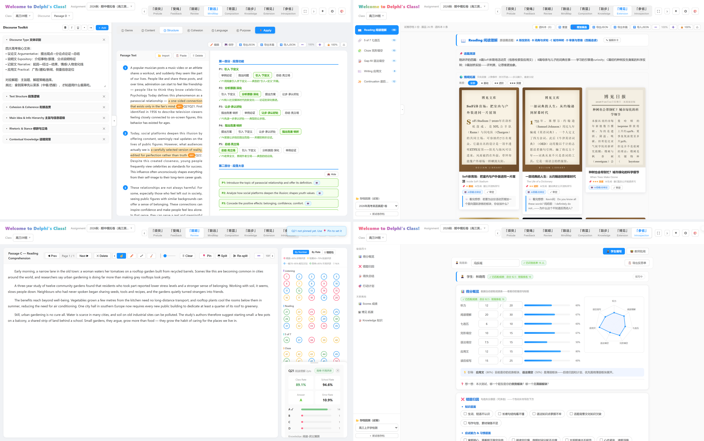

*一套系统走完一节课：从「须臾」开课到「参省」反思，八个版面环环相扣。*

</div>

---

## ✨ 为什么是「知明」

> **"假AI之善物，致学之知明。"**

「知明」不是"AI 帮老师改作业"的单点工具，而是把 AI 融入**试卷讲评全流程**的课堂操作系统：

| 设计原则 | 在产品中的落点 |
|---|---|
| 🧑‍🏫 **AI 是助手，教师是主导** | AI 生成的每一份拓展素材都带「⚠️ AI 库稿·待审定」标记，**教师点击「审定」后方可上墙**；逐题评讲、批语、作文升格全部由教师确认后生效 |
| 🔒 **数据不出浏览器** | 纯前端 + IndexedDB 本地持久化，学生成绩不经过任何服务器；一键「Hide Names」隐藏姓名用于投屏 |
| 🔁 **一节课一个闭环** | 成绩 → 评讲 → 研读 → 写作 → 沉淀 → 拓展 → 反思，每个版面的数据自动流向下一个环节 |

八个版面与系统之名，皆出**《荀子·劝学》**——命源、释义与所解教学痛点，见下方总表。

## 🗺️ 一节课的旅程

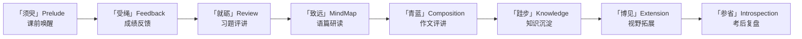

## 📖 版面命名 · 皆出《荀子·劝学》

| # | 板块 | 中文 | 《劝学》出处 | 释义 | 教学痛点 |
| --- | --- | --- | --- | --- | --- |
| 1 | Prelude 课前预热 | **须臾** | 「吾尝终日而思矣，不如须臾之所学也」 | 珍须臾之学，趣味热身，凝神开课 | 课始神散，入课迟缓，开场乏趣 |
| 2 | Feedback 成绩反馈 | **受绳** | 「故木受绳则直」 | 受成绩之绳，量直辨曲，明位笃行 | 多表难统，徒见其分，不明其位 |
| 3 | Review 试题讲评 | **就砺** | 「金就砺则利」 | 就试卷之砺，磨砺思辨，勘破错因 | 评如对答，翻卷耗神，讲过即止 |
| 4 | Mindmap 语篇探究 | **致远** | 「假舆马者，非利足也，而致千里」 | 借导图之舆，统览全篇，深达文意 | 重词轻篇，结构无形，脉络难显 |
| 5 | Composition 评价升格 | **青蓝** | 「青，取之于蓝，而青于蓝」 | 经升格之淬，一稿胜稿，青出于蓝 | 一稿定分，只评不升，改无所从 |
| 6 | Knowledge 知识积累 | **跬步** | 「不积跬步，无以至千里」 | 积讲义之跬，日累月积，以至千里 | 讲义散落，知识零碎，难积难用 |
| 7 | Extension 拓展博识 | **博见** | 「不如登高之博见也」 | 登拓展之高，博览语篇，见识日广 | 选文费力，资源难继，真题即弃 |
| 8 | Introspection 反思总结 | **参省** | 「君子博学而日参省乎己」 | 行参省之功，回望得失，行无过矣 | 只刷不省，就题论题，一错再犯 |

系统名「知明」，取自篇末"君子博学而日参省乎己，则**知明**而行无过矣"；口号"假AI之善物"，化用"君子生非异也，**善假于物**也"——**AI 即今日之"物"，善假者明。**

## 🖥️ 八大版面 · 真实界面

### ① 「须臾」Prelude —— 课前 3 分钟

> 🎯 破「课始神散，入课迟缓，开场乏趣」——珍须臾之学，趣味热身，凝神开课。

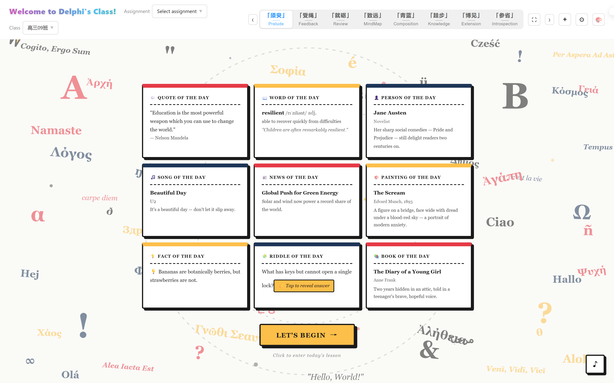

每日九宫格素材自动生成：每日一句 / 每日一词 / 每日人物 / 每日歌曲 / 每日新闻 / 每日名画 / 冷知识 / 谜语 / 每日一书，多语言文字墙营造课堂仪式感，一键 **LET'S BEGIN** 进入正课。

### ② 「受绳」Feedback —— 成绩反馈

> 🎯 破「多表难统，徒见其分，不明其位」——受成绩之绳，量直辨曲，明位笃行。

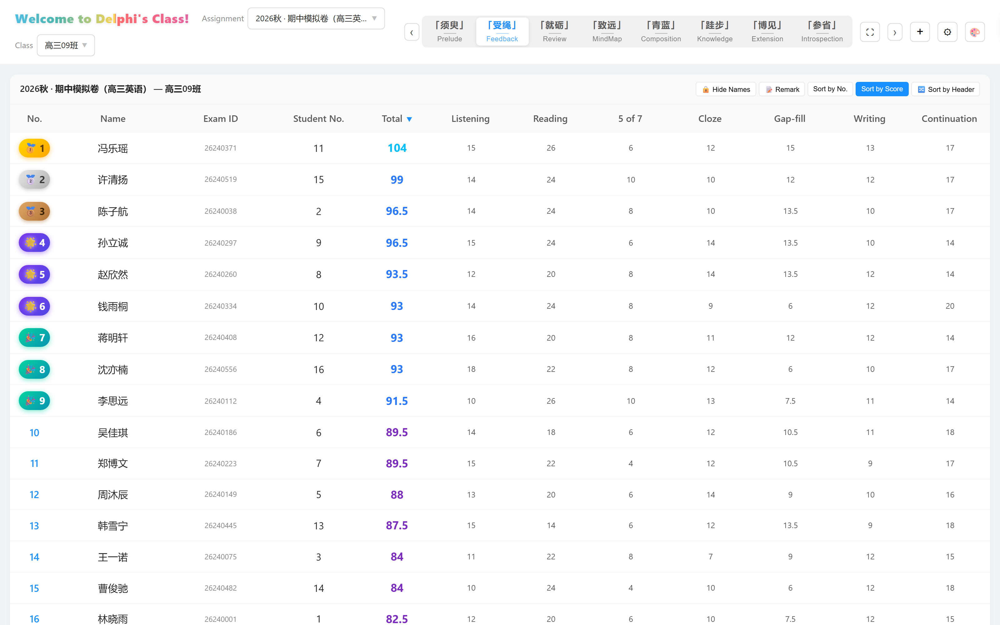

Excel 答题明细一键导入；按分数排序自动颁发 🥇🥈🥉 奖牌徽章；总分按等级着色；七题型分项得分一目了然；**隐私模式一键隐藏全部姓名**，投屏零顾虑。

### ③ 「就砺」Review —— 习题评讲（核心）

> 🎯 破「评如对答，翻卷耗神，讲过即止」——就试卷之砺，磨砺思辨，勘破错因。

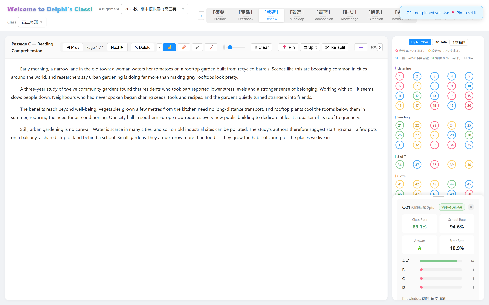

题号网格按正确率**四色分级**（🟢≥85% 不用评讲 → 🔴<60% 详细评讲）；点击题号即刻联动**左侧原文 + 右侧题目卡**：班级/年级正确率、答案分布条形图、考点标签；画笔 / 高亮 / 橡皮直接在原文上圈画标注。

### ④ 「致远」MindMap —— 语篇六步研读

> 🎯 破「重词轻篇，结构无形，脉络难显」——借导图之舆，统览全篇，深达文意。

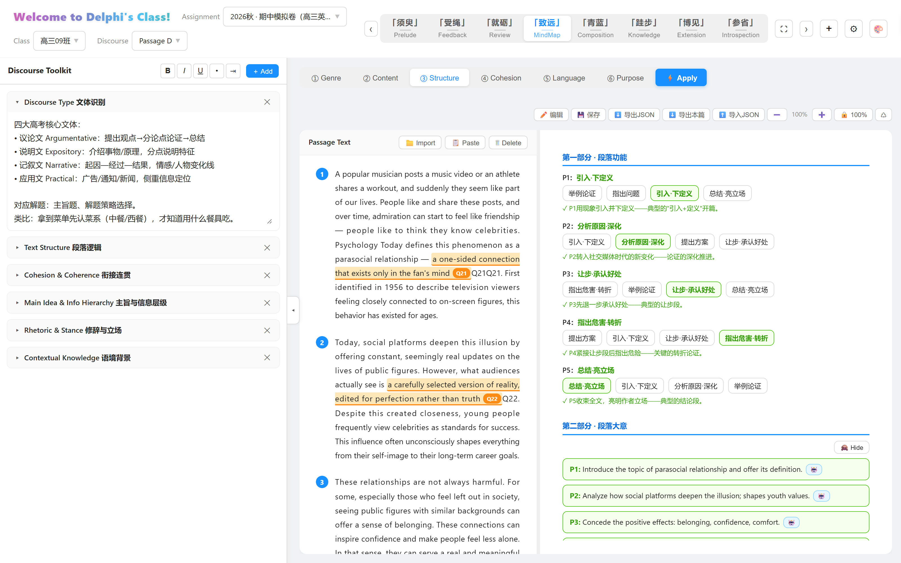

自研**苏格拉底式六步课堂引擎**：① 文体识别 → ② 主题内容 → ③ 宏观结构 → ④ 衔接连贯 → ⑤ 微观语言 → ⑥ 意图回归。学生逐段"闯关解锁"，答对才揭示下一段；答对即在**左侧原文高亮标注试题出处**（📍 Q21）；每一步都有 AI 生成的💡提示与✓讲评，节奏完全由教师掌控。

### ⑤ 「青蓝」Composition —— 作文评讲 · 评价升格

> 🎯 破「一稿定分，只评不升，改无所从」——经升格之淬，一稿胜稿，青出于蓝。

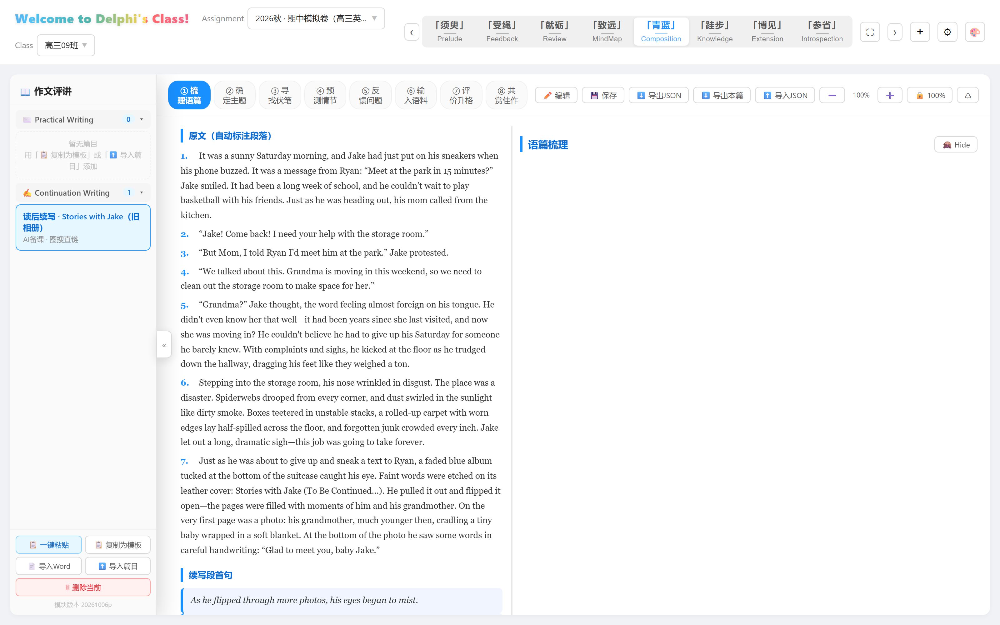

读后续写 / 应用文**八步评讲框架**：① 梳理语篇 → ② 确定主题 → ③ 寻找伏笔 → ④ 预测情节 → ⑤ 反馈问题 → ⑥ 输入语料（Show, not tell 图文语料库）→ ⑦ 评价升格 → ⑧ 共赏佳作。试卷 PDF + 答案 PDF 导入后**自动识别原文、段首句与范文**并分篇建档；导入板块 JSON（如 [`samples/样本卷-Composition-读后续写.json`](samples/样本卷-Composition-读后续写.json)）即复现上图。

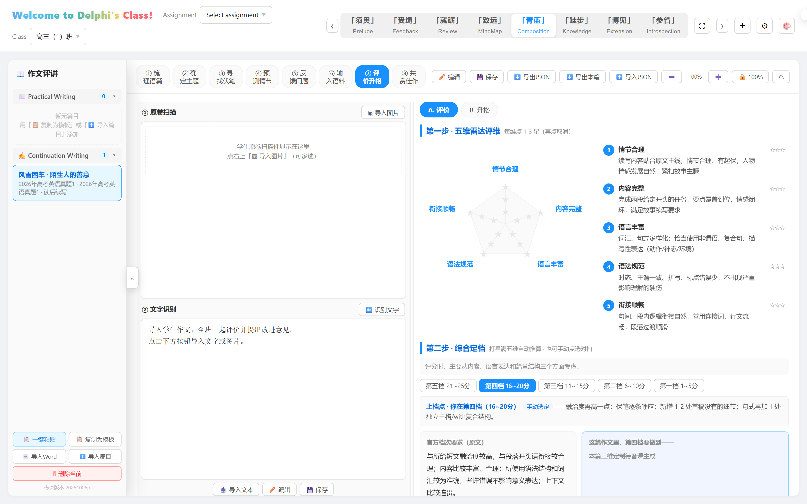

⑦ 评价升格内置**五维雷达评价**（情节合理 / 内容完整 / 语言丰富 / 语法规范 / 衔接顺畅）与**综合定档**：打星自动推算档位，给出"上档点"升格建议——先评天地，再指升路。

### ⑥ 「跬步」Knowledge —— 知识沉淀

> 🎯 破「讲义散落，知识零碎，难积难用」——积讲义之跬，日累月积，以至千里。

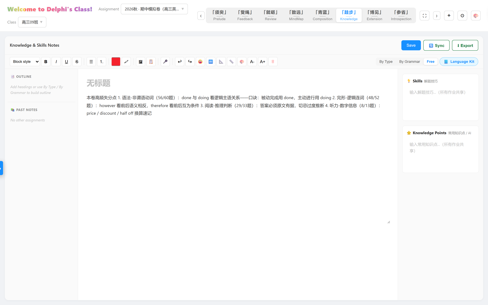

块编辑器笔记面板：自由模式 / 按题型 / 按语法三种组织方式，配套解题技巧库与常用知识点库（跨作业共享），支持导出归档。

### ⑦ 「博见」Extension —— 视野拓展

> 🎯 破「选文费力，资源难继，真题即弃」——登拓展之高，博览语篇，见识日广。

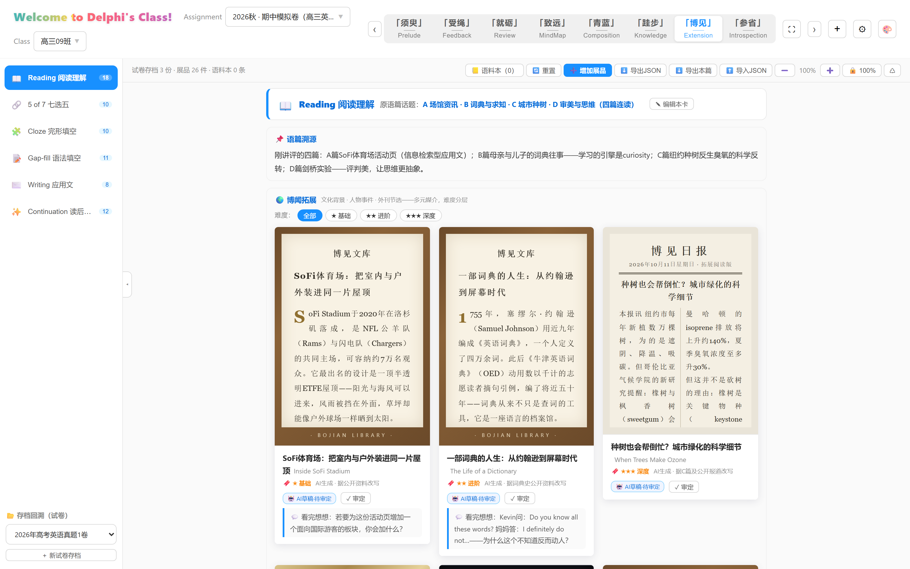

"博见，取自《劝学》'不如登高之博见'。"不讲题，讲**语篇之外的世界**——紧扣刚讲评的语篇话题，AI 生成的博物馆式**拓展展品**（博见文库 / 博见日报 / 课堂彩蛋视频）补充话题背景与文化知识：六卡片对应试卷六大题型，按语篇话题自动归档，难度三星分层；AI 稿须经**教师审定**才进入课堂。

### ⑧ 「参省」Introspection —— 学生考后复盘

> 🎯 破「只刷不省，就题论题，一错再犯」——行参省之功，回望得失，行无过矣。

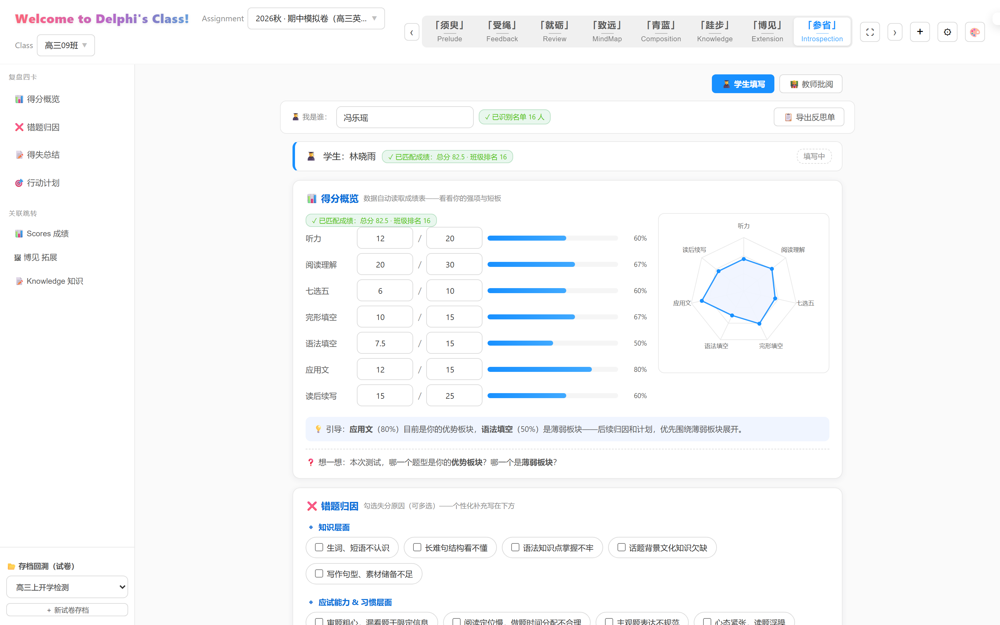

"君子博学而日参省乎己。"考试过后，**学生**输入姓名复盘试卷：自动匹配成绩表，总分、班排、七题型雷达图、强弱板块引导语一步生成；四卡总结（得分概览 → 错题归因 → 得失总结 → 行动计划）写完提交，教师在批阅模式写下批注——从"就题论题"走向"行无过矣"。

## 🤖 人机协同备课流水线

「知明」的内容生产不是"AI 一键生成"，而是一条**教师主导、AI 分工**的流水线——仓库 `skills/` 目录沉淀了 10 个板块技能（提示词工程 + 输出 JSON Schema + 示例），任意国产大模型智能体均可按规范生产内容：

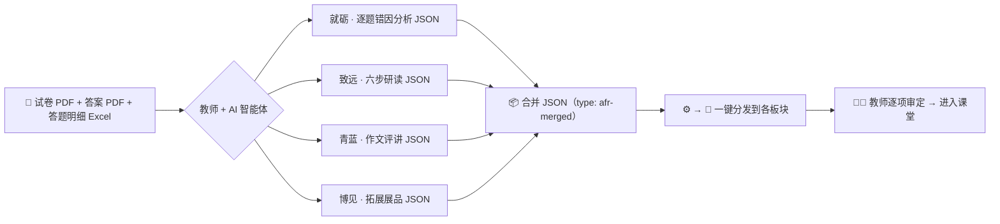

- **开发过程**：系统本身基于国产大模型（智谱 GLM 系列）+ 智能体编程框架（ZCode）人机协同开发，AI 承担架构设计与主要编码，教师负责教学设计、需求定义与逐轮实测验收——开发过程记录见 [`docs/开发纪要.md`](docs/开发纪要.md)；
- **使用过程**：试卷解析、错因分析、拓展素材由 AI 按技能规范生成，**全部经教师审定后使用**。

## 🏆 与大赛要求的对应

| 大赛要求 | 本作品落点 |
|---|---|
| 基于国产大模型 / 智能体开发框架 | 智谱 GLM 大模型 + ZCode 智能体框架完成开发；`skills/` 沉淀 10 个可复用提示词工程技能 |
| 解决教、学、管、研、育、评环节具体问题 | 八版面对应"评（就砺）/ 教（致远·青蓝）/ 学（参省）/ 研（受绳·跬步）/ 育（须臾·博见）" |
| 数据分析、互动反馈、推理预测 | 正确率四色分级、七题型雷达图、薄弱板块自动引导、错题归因 |
| 体现"人机协同"，不依赖一键生成 | AI 稿「待审定 → 教师审定」两态机制；流水线各环节教师把关 |
| 个人隐私保护，不出现未成年人画面 | 数据全部本地化不上传；隐私模式一键隐名；本 README 演示数据均为**全虚构**姓名 |

## 🚀 快速开始

**方式一 · Windows 一键启动（推荐）**：双击 [`启动服务器-免Python.bat`](启动服务器-免Python.bat)（基于 .NET，无需安装 Python），浏览器自动打开 `http://localhost:8766`

**方式二 · 任意静态服务器**：

```bash
python -m http.server 8766 --bind 127.0.0.1
# 访问 http://127.0.0.1:8766
```

**方式三 · GitHub Pages**：纯静态站点，Settings → Pages 一键托管即可（仅"每日歌曲"自动扫描在该环境下退化为固定文件名）。

> 🎁 **30 秒看满数据效果**：启动后点右上角 **⚙ → Import Backup**，选择 [`docs/演示备份-知明.json`](docs/演示备份-知明.json)，即可加载一个完整的虚构班级（16 名学生、67 题、含各板块演示数据）。*演示姓名均为虚构。*

### 🧪 完整样本数据

[`samples/`](samples/) 内置一套**真实讲评流程的完整样本**（2026 高考英语真题 I 卷）：试卷与答案 PDF/DOCX、听力音频、两个班 116 名学生的答题明细 Excel、以及全部板块的 AI 分析 JSON（含合并包与错题包）。**所有姓名与准考证号均经脚本自动脱敏为虚构**，可放心用于体验、教学与二次开发——逐步导入指引见 [`samples/README.md`](samples/README.md)。

浏览器要求：Chrome / Edge（推荐）/ Firefox / Safari。更新页面后请 **Ctrl+Shift+R** 强制刷新。

## 🔒 数据安全与隐私

- 所有数据保存在**浏览器本地**（IndexedDB + localStorage），关闭浏览器不丢失，不经过任何服务器；
- 各板块均提供 **JSON 导出 / 导入**，跨设备迁移无需联网；
- 「受绳」版面内置 **Hide Names** 一键隐名，保护学生隐私；
- 仓库 `.gitignore` 永久排除 `Data/`（真实试卷与成绩）与本地音频。

## 📁 目录结构

```
AIkoko/
├── index.html              # 主页面（八版面 + 六步研读引擎）
├── script-v2.js            # 「知明」主逻辑（内部代号 AFR）
├── essay-review.js         # 「青蓝」作文评讲模块
├── bojian.js               # 「博见」视野拓展模块
├── introspection.js        # 「参省」考后复盘模块
├── extension-高考真题.json  # 博见拓展包（真题语篇的话题·文化知识素材，板块内导入）
├── libs/                   # 离线第三方库（xlsx / fabric / pdf.js + 中文 cmaps / jszip ...）
├── skills/                 # 10 个 AI 备课技能（提示词工程 + JSON Schema + 示例）
├── samples/                # 完整样本数据（真题卷×PDF/音频/明细表/全板块JSON，已脱敏）
├── docs/
│   ├── 开发纪要.md          # 架构决策、踩坑实录、修改守则
│   ├── 演示备份-知明.json   # 一键导入的虚构演示数据
│   └── screenshots/        # 本页截图
├── server.ps1              # PowerShell 本地服务器（免 Python，含歌曲接口）
├── 启动服务器.bat / 启动服务器-免Python.bat
└── Song of the Day/        # 课前歌曲（MP3 自备）
```

## 🛠️ 技术栈

原生 HTML / CSS / JavaScript（零框架零构建）· IndexedDB + localStorage 持久化 · pdf.js（含中文 CID 字符映射，试卷 PDF 离线解析）· SheetJS（Excel）· Fabric.js（Canvas 圈画）· JSZip / html2canvas / jsPDF（导出）· Mermaid（本页图表）

## 📄 License

[MIT](LICENSE) © 2026 PhidelDelphi。`libs/` 内第三方库归各自作者所有，遵循其原许可。

---

<div align="center">

**假AI之善物 · 致学之知明**

*须臾之所学 · 受绳而定直 · 就砺而得利 · 致远而行远*

*青出于蓝 · 跬步千里 · 博见天下 · 参省己身*

</div>
